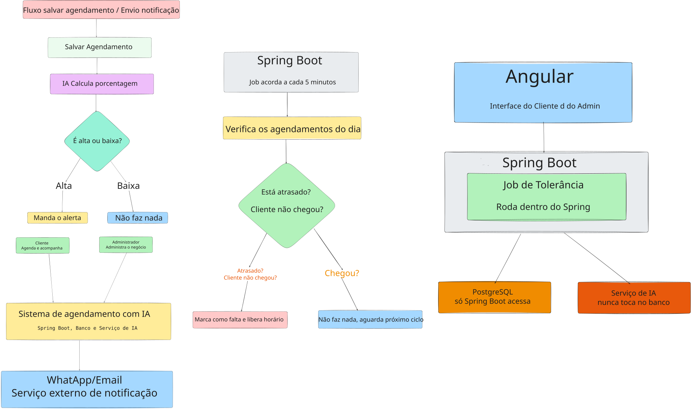
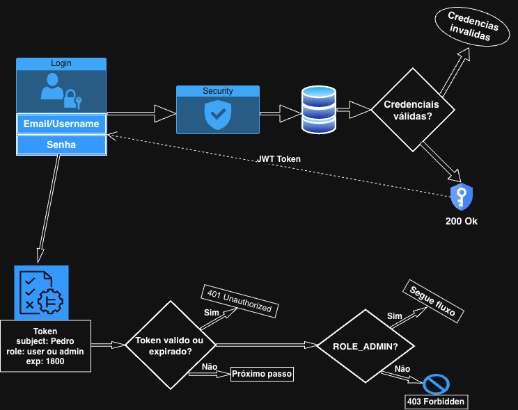
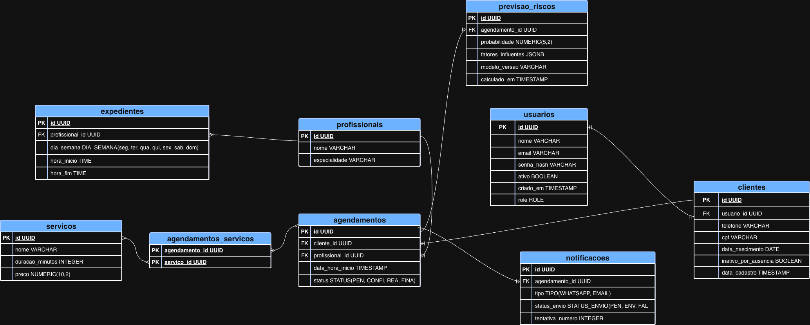

# 📅 Sistema de Agendamento Inteligente com Previsão de No-Show

> Uma API RESTful robusta que une Spring Boot e Inteligência Artificial para otimizar agendas e prever faltas de clientes, mitigando prejuízos financeiros.

## 🎯 Sobre o projeto

O "no-show" (quando um cliente agenda um horário e não comparece) é uma das maiores dores em negócios baseados em serviços, gerando ociosidade na equipe e impacto direto no faturamento. Solucionar esse problema exige mais do que um simples CRUD de agendamentos; exige previsibilidade.

Este sistema foi projetado para ser uma solução completa de gestão de agendas com um diferencial estratégico: um módulo integrado de Machine Learning. Ao analisar o histórico de marcações, o sistema calcula a probabilidade de um cliente faltar, permitindo que a clínica ou estabelecimento adote medidas preventivas, como o envio de notificações de confirmação reforçadas ou a gestão de filas de espera automatizadas (tolerância de atraso).

Atualmente, o projeto encontra-se em desenvolvimento ativo, com a API core (Spring Boot) estruturada sob os princípios de Clean Architecture e a suíte de testes da camada de domínio consolidada.

## ✨ Funcionalidades

- [x] **Cadastro e Perfil de Clientes:** Gestão segura de dados com mascaramento de informações sensíveis (LGPD).
- [x] **Autenticação e Autorização:** Segurança baseada em JWT com controle rígido de perfis (Admin vs. Cliente) prevenindo falhas de IDOR.
- [ ] **Agendamento Inteligente:** Validação de conflitos de horários em tempo real.
- [ ] **Previsão de Falta (IA):** Integração com motor Python/Scikit-learn para score de probabilidade de no-show.
- [ ] **Notificações Preventivas:** Alertas automáticos baseados na probabilidade de falta.
- [ ] **Job de Liberação de Horário:** Rotina automatizada para cancelar agendamentos após limite de tolerância de atraso.

## 🏗️ Arquitetura e Decisões Técnicas

**Separação de Contextos (Spring Boot + Python)**
A arquitetura foi dividida entre o serviço principal de gestão (Spring Boot) e o motor de previsão (Python). Esta decisão foi motivada por dois fatores:
1. **Ecossistema:** O Java/Spring é o padrão ouro para transações robustas e segurança. Em contrapartida, o ecossistema Python é imbatível para o treino e inferência de modelos preditivos.
2. **Escalabilidade Independente:** O processamento de modelos de IA consome recursos de forma diferente do tráfego web. Separar os serviços permite escalar a API de agendamentos independentemente do motor de previsão.

**Segurança e Gestão de Sessão (JWT com HMAC)**
Optou-se pela utilização de JWT com assinatura simétrica (HMAC). Como o serviço que emite o token é o mesmo que o valida (Resource Server centralizado), o HMAC oferece excelente performance e baixa complexidade de configuração em comparação a chaves assimétricas (RSA), mantendo a integridade estrita dos dados.

**Padrões de Qualidade e Testes de Domínio**
O projeto adota uma abordagem rigorosa de testes unitários. A utilização do padrão *Object Mother* (via Factories) garante a consistência na geração de dados mockados. A camada de serviço possui cobertura validando fluxos de sucesso e exceções complexas, garantindo a inocuidade do banco de dados perante falhas de regras de negócio.

### Arquitetura e Diagramas

**Arquitetura e Fluxo de Negócio**



**Fluxo de Autenticação**



**Modelo Entidade-Relacionamento (MER)**



## 💻 Tecnologias Utilizadas

- **Backend:** Java 21, Spring Boot 3, Spring Security, Spring Data JPA, Hibernate, MapStruct, Lombok.
- **Banco de Dados:** PostgreSQL, Migrations com Flyway.
- **Inteligência Artificial:** Python, Pandas, Scikit-learn.
- **Infraestrutura:** Docker, Docker Compose, GitHub Actions (CI/CD).
- **Testes:** JUnit 5, Mockito.

## 🚀 Como rodar localmente

### Pré-requisitos
- Java 21
- Docker e Docker Compose
- Maven

### Passo a passo

1. Clone o repositório
```bash
git clone https://github.com/lucianosantos-dev/sistema-agendamento-ia.git
cd sistema-agendamento-ia
```

2. Configure as variáveis de ambiente
```bash
cp .env.example .env
# Preencha os valores necessários (credenciais, JWT secret, etc.) no arquivo .env
```

3. Suba a infraestrutura de dados com Docker
```bash
docker compose up -d
```

4. Execute a aplicação Spring Boot
```bash
mvn spring-boot:run
```

A API estará disponível em `http://localhost:8080`.

## 📚 Documentação Adicional

- [Documento de Requisitos](docs/requisitos/requisitos.md)
- [Diretório de Diagramas de Arquitetura](docs/diagramas/)

## 👨‍💻 Autor

**Luciano Santos**  
Desenvolvedor Backend Java | Entusiasta em Clean Architecture & IA

[LinkedIn](https://www.linkedin.com/in/lucianosantos-dev) · [GitHub](https://github.com/lucianosantos-dev)
